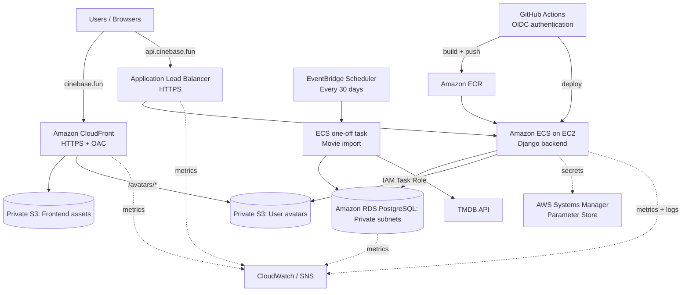

# CineBase Infrastructure

Infrastructure as Code for **CineBase**, a movie discovery and catalog platform. This repository provisions and configures the application's AWS infrastructure with Terraform, including networking, frontend delivery, backend hosting, CI/CD permissions, database, storage, monitoring, and scheduled data imports.

**Infrastructure release:** [`v1.0.0`](https://github.com/CineBase-org/cinebase-infrastructure/tree/v1.0.0) (Git tag)  
**Frontend:** https://cinebase.fun  
**Backend API:** https://api.cinebase.fun  
**Backend repository:** https://github.com/CineBase-org/cinebase-backend  
**Infrastructure region:** `eu-central-1` (Frankfurt), with CloudFront-related AWS resources also in `us-east-1`.

> **Scope:** This is a team/portfolio project designed with cost-conscious infrastructure choices. It should not be treated as a production hardening reference without reviewing security, recovery, capacity, and availability requirements.

## Architecture



Cloudflare manages DNS records for the application domains. ACM provides TLS certificates: the CloudFront certificate is in `us-east-1`, while the backend ALB certificate is in `eu-central-1`.

## Technology stack

| Area | Technology / implementation |
| --- | --- |
| Infrastructure as Code | Terraform; AWS provider `6.66.0`, Cloudflare provider `5.27.0` |
| Compute | Amazon ECS with EC2 Capacity Provider, Auto Scaling Group, ECS-optimized Amazon Linux 2023 |
| Containers | Docker images in Amazon ECR; ECS `bridge` network mode |
| Frontend | Amazon S3, Amazon CloudFront, Origin Access Control (OAC) |
| Backend routing | Application Load Balancer, HTTPS, blue/green target groups |
| Database | Amazon RDS for PostgreSQL, private subnets |
| Identity and secrets | IAM roles, GitHub OIDC, AWS Systems Manager Parameter Store |
| CI/CD | GitHub Actions in application repositories; ECR and ECS integration |
| Deployment verification | ECS blue/green lifecycle hook with AWS Lambda smoke tests |
| Monitoring | Amazon CloudWatch dashboards and alarms, Amazon SNS email notifications |
| Automation | Amazon EventBridge Scheduler and one-off ECS tasks |
| DNS and certificates | Cloudflare DNS, AWS Certificate Manager |

## Infrastructure components

### Networking and compute

- VPC with public and private subnets across three Availability Zones in `eu-central-1`.
- Internet Gateway and routing for public subnets; no NAT Gateway in the current cost-optimized architecture.
- ECS on EC2, using an Auto Scaling Group and ECS Capacity Provider with managed scaling and draining.
- ECS container instances run in public subnets; RDS remains private.
- Security Groups restrict backend traffic from the ALB to ECS and PostgreSQL traffic from ECS EC2 to RDS.
- EC2 Instance Profile includes ECS permissions and `AmazonSSMManagedInstanceCore` for Session Manager access without SSH.

### Backend and deployment strategy

- Django runs in an ECS Service with two desired tasks.
- An ALB uses separate blue and green target groups; the ECS Service uses the `BLUE_GREEN` deployment strategy.
- Before production traffic shifts, an ECS lifecycle hook invokes a Lambda smoke-test function.
- Smoke tests use the `X-Smoke-Test: true` header to reach the test deployment and check read-only API endpoints, including health, movies, genres, comments, and image configuration.
- Application deployment is driven by GitHub Actions, which builds and publishes an image to ECR, registers a new ECS Task Definition revision, and updates the ECS Service.
- Terraform intentionally uses `ignore_changes = [task_definition]` for the ECS Service so CI/CD can manage application revisions independently. **A Terraform apply that registers a new Task Definition does not itself deploy that revision to the running service.**

### Frontend and avatar storage

- The frontend uses a private S3 bucket delivered through CloudFront.
- A second private S3 bucket stores user avatars under the `avatars/` object prefix.
- CloudFront uses OAC to read both buckets. The `/avatars/*` cache behavior routes to the avatar bucket with the AWS managed `CachingDisabled` policy; the frontend uses `CachingOptimized`.
- The backend accesses avatar objects using its ECS Task Role, with permissions scoped to `avatars/*`.
- Images are served through `https://cinebase.fun/avatars/...` rather than direct public S3 access.

### Database

- RDS PostgreSQL uses private subnets and an encrypted `gp3` volume.
- The current Terraform configuration uses `db.t4g.micro`, 20 GiB of allocated storage, a 7-day backup retention period, and single-AZ deployment.
- The database is not publicly accessible. The tested administrative path is a local PostgreSQL client through an SSM port-forwarding session on an existing ECS EC2 instance.
- A separate, least-privilege account for the data analyst is a follow-up access-control task, not part of the `v1.0.0` deployment.

### Monitoring and alerts

Three CloudWatch dashboards cover the backend, database, and frontend. Terraform also configures CloudWatch alarms for ECS CPU/memory and task count, RDS CPU and free space, ALB/backend 5xx rates, and CloudFront 5xx rate. Alarm notifications are sent to SNS email subscriptions.

### Scheduled movie import

EventBridge Scheduler invokes a separate one-off ECS task every 30 days using the existing ECS Capacity Provider. It overrides the container command with:

```bash
python manage.py import_movies --source new
```

The configured Scheduler target is explicitly pinned to **ECS Task Definition revision `14`**. It does **not** automatically track the latest revision published by GitHub Actions. This is intentional for the first stable implementation and should be reviewed when the import logic changes.

The import was tested through a one-time Scheduler invocation. Operational verification should check the ECS task's container exit code and CloudWatch logs, not merely that `RunTask` succeeded.

## Repository structure

```text
.
├── main.tf                     # Root module wiring
├── provider.tf                 # Providers and remote state backend
├── variables.tf                # Root input variables
├── outputs.tf                  # Root outputs
├── modules/
│   ├── acm/                    # TLS certificates
│   ├── backend/                # ECS, EC2, IAM, S3 avatars, Scheduler
│   │   └── scheduler.tf
│   ├── cloudflare/             # DNS records
│   ├── cloudwatch/             # Dashboards, alarms, SNS
│   ├── database/               # Private RDS PostgreSQL
│   ├── ecr/                    # Container registry and deploy IAM role
│   ├── frontend/               # CloudFront, frontend S3, OAC, frontend IAM
│   ├── github-oidc/            # GitHub OIDC provider
│   ├── lambda/                 # Blue/green smoke-test Lambda
│   ├── loadbalancer/           # ALB, listeners, blue/green target groups
│   ├── network/                # VPC, subnets, routes, Internet Gateway
│   └── ssm/                    # Application secrets
└── .gitignore
```

The application CI/CD workflows live in the respective application repositories, not in this Terraform repository.

## Prerequisites

- Terraform CLI compatible with the pinned providers.
- AWS credentials with the permissions required to manage the resources defined here.
- Access to the existing S3 Terraform state bucket and lock objects.
- A Cloudflare API token with permissions to manage DNS records in the target zone.
- Configuration values for the required Terraform variables, including networking, domains, GitHub repositories, AWS region, AMI SSM parameter, and instance type.
- Secure access to the PostgreSQL password, Django secret key, and TMDB API key.

Terraform remote state is configured in `provider.tf` using an S3 backend and `use_lockfile = true`. The backend bucket must already exist before `terraform init`; this repository does not bootstrap it.

The Cloudflare provider reads its authentication token from the environment (for example, `CLOUDFLARE_API_TOKEN`). The root Terraform variables `db_password`, `django_secret_key`, and `tmdb_api_key` are declared sensitive and ephemeral. **Do not commit secret values, `.tfvars` files, Terraform state, saved plans, or AWS credentials.**

## Terraform workflow

Run these commands from the repository root, after configuring AWS/Cloudflare authentication and supplying the required variables securely:

```bash
terraform init
terraform fmt -check -recursive
terraform validate
terraform plan -out=tfplan
terraform apply tfplan
terraform output
```

Review the entire plan before applying it. Terraform can change network access, IAM permissions, ECS resources, and persistent storage. Provider-managed AMI parameters may cause an EC2 Launch Template version update even when the relevant HCL has not changed.

**Important:** `terraform destroy` is destructive. The current configuration includes `force_destroy = true` on S3 content buckets, `skip_final_snapshot = true` for RDS, and ECR deletion settings intended for a disposable project environment. Do not reuse these defaults for production data.

## Operational checks

### Frontend and backend

```bash
curl -I https://cinebase.fun
curl https://api.cinebase.fun/health/
```

For backend deployments, inspect the ECS Service's deployment status, ALB target-group health, Lambda lifecycle-hook logs, and CloudWatch alarms. A successful Terraform apply is not a substitute for a successful application deployment.

### ECS and Scheduler

Check the ECS cluster `cinebase-cluster` for running backend service tasks and stopped one-off import tasks. The scheduled import is configured as `cinebase-scheduler` in EventBridge Scheduler (`eu-central-1`) with `rate(30 days)`.

A stopped one-off task is expected after the import finishes; check that the container exited successfully and review its CloudWatch log stream. Avoid running additional import tasks during resource-intensive blue/green deployments if EC2 capacity is limited.

### Private PostgreSQL access through SSM

On an authorized workstation with AWS CLI and Session Manager Plugin installed, start a port-forwarding session through an SSM-managed ECS EC2 instance:

```bash
aws ssm start-session \
  --region eu-central-1 \
  --target <SSM_MANAGED_EC2_INSTANCE_ID> \
  --document-name AWS-StartPortForwardingSessionToRemoteHost \
  --parameters '{"host":["<PRIVATE_RDS_ENDPOINT>"],"portNumber":["5432"],"localPortNumber":["15432"]}'
```

Then use a second terminal and the relevant PostgreSQL credentials:

```bash
psql 'host=127.0.0.1 port=15432 dbname=cinebase_db user=<DB_USER> sslmode=require'
```

Keep the SSM session open while using the connection. SSM access and PostgreSQL credentials are separate authorization layers. Provide analysts with explicitly scoped database permissions and scoped SSM access instead of administrative credentials.

## Security and design decisions

- **No long-lived AWS keys in GitHub Actions:** deployments authenticate using GitHub OIDC and dedicated IAM roles.
- **Private storage:** frontend and avatar S3 buckets block public access; CloudFront OAC reads permitted objects.
- **Private database:** RDS has no public endpoint exposure; PostgreSQL traffic is restricted by Security Groups.
- **Separated roles:** EC2 instance, ECS execution, Django task, CI/CD, ECS infrastructure, Scheduler, and Lambda roles have different responsibilities.
- **Cost-conscious hosting:** ECS on EC2 and a single-AZ RDS deployment reduce recurring costs, with trade-offs in capacity and availability.
- **Controlled deployments:** ALB health checks, blue/green deployment, and smoke tests provide checks before shifting production traffic.

## Known limitations and follow-up work

- Grant the data analyst limited PostgreSQL and SSM permissions based on their required tables and use cases.
- The Scheduler is pinned to Task Definition `:14`; update the target and its IAM `ecs:RunTask` permission together when changing revisions.
- Add explicit alerting for failed scheduled imports, including application-level failures after an ECS task launches.
- Revisit ECS task and EC2 capacity before increasing traffic or introducing additional background workloads.
- Reassess database high availability, final snapshots, backup/restore testing, S3 deletion settings, and disaster recovery before a production rollout.
- Keep README instructions synchronized with the Terraform configuration and application deployment workflows.

## Related repositories

- [CineBase backend](https://github.com/CineBase-org/cinebase-backend)
- [CineBase frontend](https://github.com/CineBase-org/cinebase-frontend)
- [CineBase infrastructure](https://github.com/CineBase-org/cinebase-infrastructure)

---

**Release note:** `v1.0.0` captures the first stable infrastructure baseline. Subsequent improvements and access-control changes can be made through normal commits and future version tags.
